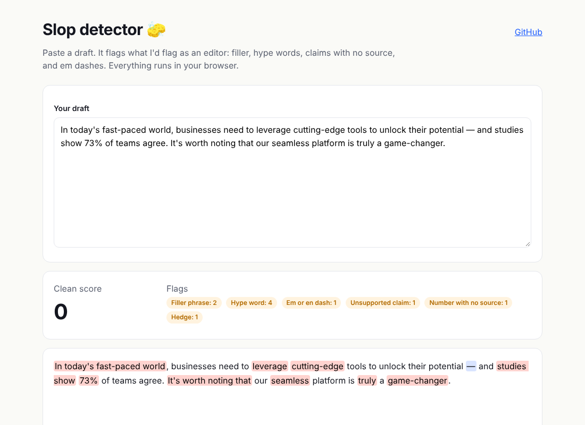

# Slop detector 🧽

**Paste a draft, see what an editor would cut.** Flags filler phrases, hype words ("leverage", "seamless", "game-changer"), claims with no source, numbers with no citation, hedges and em dashes. Runs fully in your browser; nothing is sent anywhere.

✨ **Try it:** https://tiwalade-joanna-okedara.github.io/slop-detector/



## Why

I edit a lot of content, my own and other people's, and AI drafts have made the same handful of tics everywhere. This turns my editing pass into a checklist you can run in five seconds before a human editor (or a client) sees the draft.

## Use it in code

```js
const { scanSlop } = require('./slop.js');
scanSlop("It's worth noting that our seamless tool is a game-changer.");
// { hits: [...], words: 10, score: 70 }
```

## Add your own rules

Rules live in [`slop.js`](slop.js) as plain objects: `{ id, label, cls, re, tip }`. Add a regex, open a pull request.

---
Made by [Tiwalade Joanna Okedara-Kalu](https://github.com/tiwalade-joanna-okedara) · MIT licence
